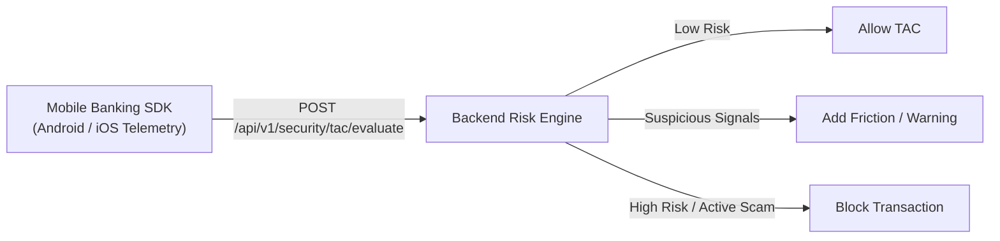

# SmartTAC Shield

A real-time anti-scam security module for mobile banking applications and backend risk engines. SmartTAC Shield evaluates live device telemetry and environmental signals **before** generating or approving a Transaction Authorization Code (TAC) to stop social engineering and remote-control scams.

## Architecture Overview

## Key Security Signals
- **Active Call Detection:** Detects ongoing voice calls during transfer authorization (`TelephonyManager` on Android, `CallKit` / `CXCallObserver` on iOS).
- **Screen Sharing & Mirroring Detection:** Identifies active screen recording, AirPlay/SharePlay, or virtual displays (`MediaProjection` / `DisplayManager` on Android, `UIScreen.main.isCaptured` on iOS).
- **Overlay & Device Integrity Checks:** Checks `SYSTEM_ALERT_WINDOW` overlays and Google Play Integrity attestation on Android.

## Risk Evaluation API
- **Endpoint:** `POST /api/v1/security/tac/evaluate`
- **Headers:** `Authorization: Bearer <token>`, `X-Device-ID: <uuid>`
- **Decisions:** `Allow`, `Friction`, or `Block`

## Documentation
See the full technical specification in [PRD.md](./PRD.md).